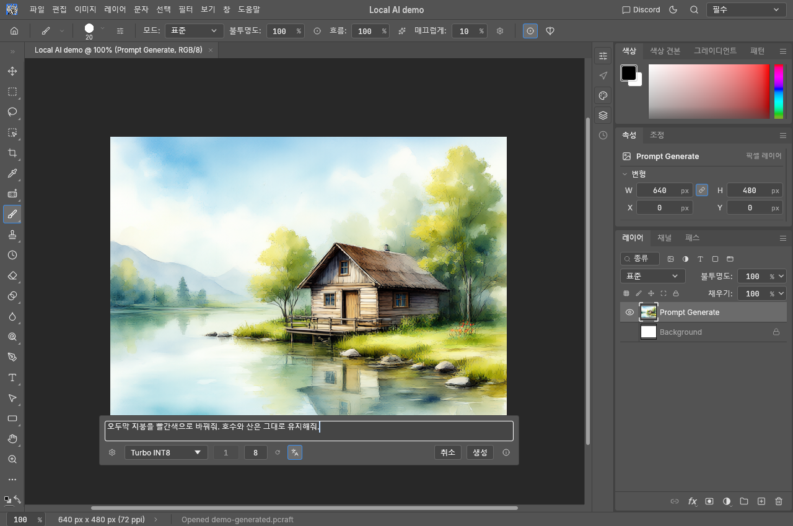
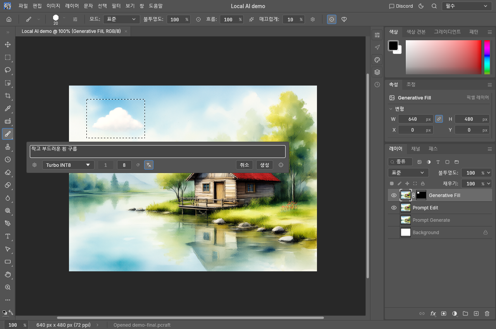
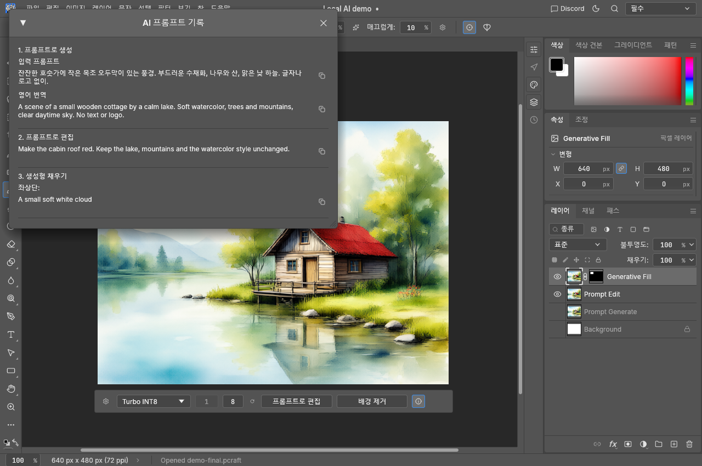

# PhotoCraft — 로컬 Qwen AI 기능

[English](README.md) · [포터블 릴리스 다운로드](https://github.com/david419kr/photocraft/releases/latest)

PhotoCraft에 **포토샵 스타일의 로컬 생성형 AI 편집**을 추가한 fork입니다. ComfyUI의 Qwen Image 2.1을 사용하고 결과를 새 레이어로 추가하며, 프롬프트 기록도 저장합니다. AVIF 열기·저장·내보내기도 지원합니다. 아래는 이 fork의 추가 기능 안내입니다.

## 설치와 실행

전제 환경은 **Windows x64 + NVIDIA RTX GPU**, CUDA 13을 지원하는 NVIDIA 드라이버입니다. 최초 다운로드에는 인터넷이 필요하며, 이후 생성·번역은 로컬에서 실행됩니다.

1. 릴리스 ZIP을 쓰기 가능한 폴더에 압축 해제합니다. 간단한 오프라인 안내는 `README.txt`에 있습니다.
2. `install-qwen-image21.cmd`를 실행합니다. **기본 설치 경로를 쓰려면 Enter만 누르세요.** 경로·모델·번역 선택 질문은 처음에 모두 받으며, 이후에는 완료될 때까지 기다리면 됩니다.
3. 일반 Qwen 2.1, Turbo, 둘 다 또는 수동 설치를 선택합니다. 모델 다운로드 시 필수 텍스트 인코더·VAE도 설치합니다. SageAttention이 호환되지 않으면 PyTorch attention을 사용합니다.
4. 번역은 선택 사항이며 **1.8B 모델을 권장합니다.** VRAM 사용량이 작아 이미지 모델과 함께 상주시키기 좋습니다. 7B는 VRAM을 더 사용하므로 GPU에 따라 모델 해제·오프로딩이 필요할 수 있습니다.
5. **`0. Run-Qwen-Image21`** 바로가기로 ComfyUI를 시작한 다음 `photocraft.exe`를 실행합니다. 브라우저는 자동으로 열리지 않으며 기본 연결 주소는 `http://127.0.0.1:8188`입니다.

나중에 모델이나 번역 기능을 추가하려면 설치 CMD를 다시 실행합니다. 기존 호환 ComfyUI도 사용할 수 있습니다. 서비스와 필수 모델을 감지하면 AI 바가 나타나고, 번역 모델을 감지했을 때만 번역 버튼이 나타납니다.

[상세 설치 안내·스크립트 소스](qwen-image21-installer/README.md)

## 프롬프트로 생성·편집

- **프롬프트로 생성:** 완전 투명 또는 순수 흰색 캔버스에서 선택 영역이 없거나 전체 선택일 때 사용합니다. 결과 크기는 캔버스 크기입니다. 예: “잔잔한 호숫가에 작은 목조 오두막이 있는 수채화 풍경.”
- **프롬프트로 편집:** 기존 이미지에 부분 선택이 없을 때 전체 이미지를 편집합니다. 예: “오두막 지붕을 빨간색으로 바꿔줘. 호수와 산은 그대로 유지해줘.”
- 결과는 새 레이어로 추가합니다. 전체 생성·편집 시 기존 표시 레이어는 숨겨 투명도 변화도 쉽게 확인할 수 있습니다. 실행 취소하면 이전 상태로 돌아갑니다.
- **배경 제거**는 원클릭으로 실행하며, 입력칸에서 **Ctrl+Enter**로 생성할 수도 있습니다.

*예시 이미지는 공식 Qwen Image 2.1 Turbo로 로컬에서 생성했습니다. 강조된 언어 아이콘은 영어 자동 번역 토글입니다. 토글과 번역 모델 선택은 앱을 다시 실행해도 기억합니다.*

## 생성형 채우기·제거

이미지의 일부를 선택하면 **생성형 채우기**를 사용합니다. 원하는 변경을 입력하거나, 빈 프롬프트 또는 **제거** 버튼으로 선택된 내용을 지우고 주변 배경을 복원합니다. 빈 캔버스라도 부분 선택이 있으면 이 방식으로 처리합니다. 채우기는 아래 이미지를 유지하면서 새 레이어에 추가합니다.

*예시는 지붕을 빨간색으로 편집한 뒤 좌상단 선택 영역에 작은 흰 구름을 추가한 결과입니다.*

생성 직후 회전 화살표는 **원본 입력·프롬프트·설정을 유지하고 시드만 바꿔 재생성**합니다. 모델 설정에서는 호환 `.safetensors` 모델·텍스트 인코더를 등록하고 스텝·CFG를 조절합니다. 기본 스텝은 일반 모델 25, Turbo 8이며 공식 Turbo의 CFG는 1.0으로 유지합니다.

## 프롬프트 기록

오른쪽 **ⓘ** 버튼으로 생성·편집·채우기 기록을 순서대로 확인합니다. 번역을 사용했으면 원문과 영어 번역문을 함께 저장하고, 채우기는 대략적인 9분할 위치도 표시합니다. 실행 취소하면 해당 기록이 빠지고 다시 실행하면 복구됩니다.

PNG·AVIF·PSD·`.pcraft`처럼 메타데이터를 지원하는 형식으로 저장하면 다시 열어서 기록을 확인할 수 있습니다. **내보내기**에서는 기록을 유지하려면 **메타데이터: 모두**를 선택하세요. **없음**은 메타데이터를 제거합니다. 일부 형식은 기록 저장을 지원하지 않습니다.

VRAM 여유가 있으면 번역·이미지 모델을 유지해 반복 작업의 재로딩을 줄입니다. 어느 모델이든 변경하면 둘 다 명시적으로 해제한 뒤 새 설정을 사용합니다. 감지된 모델이 하나라면 선택 메뉴는 생략됩니다.

## 추가 사항과 버전

- AVIF 열기·저장·내보내기를 지원합니다. 현재 AVIF 내보내기는 SDR 중심이며 HDR 보존은 후순위입니다.
- 숫자 입력칸 위의 휠 증감과 AI 입력칸의 Ctrl+Enter를 지원합니다.
- 일반 단축키·시작 도구·내보내기 기본값은 원본 동작을 유지합니다.
- 태그는 **`YYMMDD-원본버전`**입니다. `261012-0.6.0`의 날짜는 fork 빌드이고 `0.6.0`은 대응 원본 버전입니다. ComfyUI 설치본은 **v0.39.0**으로 고정합니다.

[AI 구현 문서](docs/comfyui.md) · [원본 PhotoCraft](https://github.com/storytold/photocraft)

원본 PhotoCraft와 그 기여자를 기반으로 한 독립 수정본입니다. 배포 조건에 따라 ArtCraft 상표 로고는 포함하지 않으며, 원본 라이선스와 출처 표시는 유지합니다.
