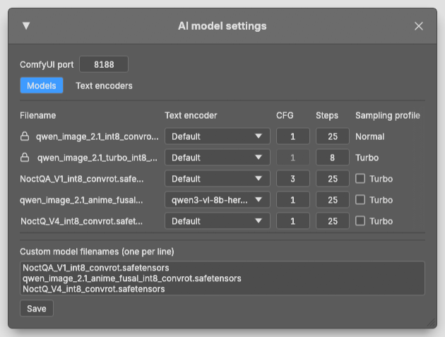
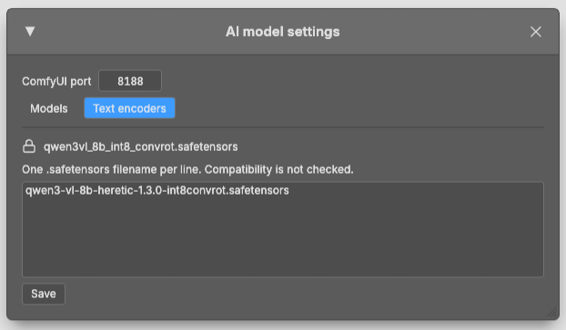
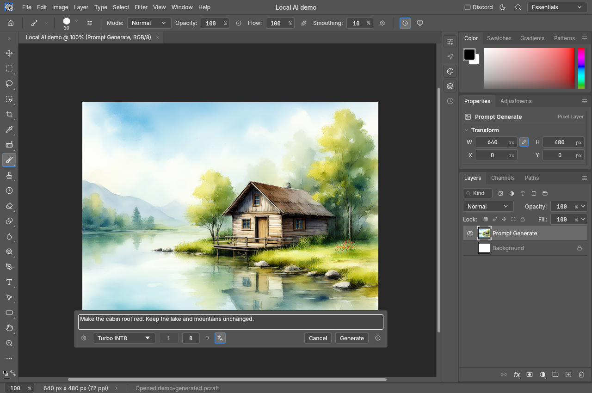
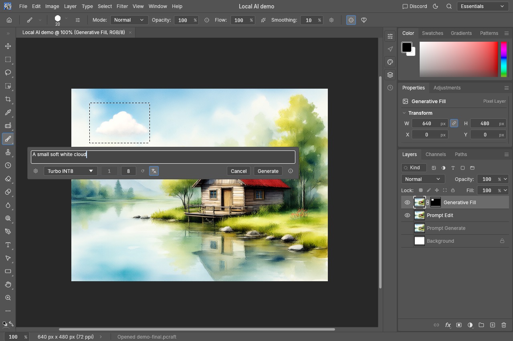
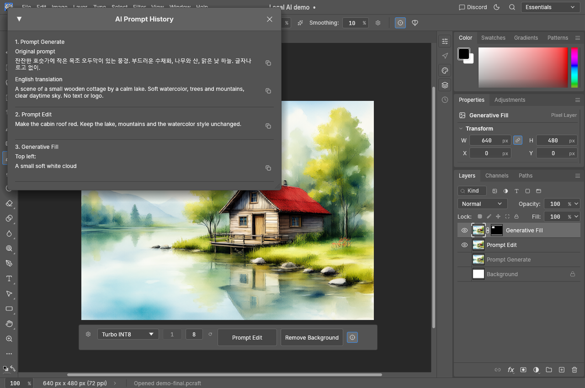

# PhotoCraft — Local Qwen AI

[한국어](README.ko.md) · [Download the portable release](https://github.com/david419kr/photocraft-qwen-edit/releases/latest)

A native Rust PhotoCraft fork focused on **Photoshop-style local generative editing** through ComfyUI and Qwen Image 2.1, with optional prompt translation, new result layers and saved prompt history. AVIF opening, saving and export are also included.

## Demo video

English UI walkthrough: generate an image, edit it, and fill or remove selected content.

https://github.com/user-attachments/assets/4e88073f-a747-476b-ac18-3a0c43262e91

## Setup

This release targets **Windows x64 + NVIDIA RTX**, with a CUDA 13 compatible NVIDIA driver. Initial downloads need internet access; generation and translation then run locally.

Tested on RTX 3090 (24 GB), RTX 4090 (24 GB), and RTX 4090 Laptop (16 GB).

1. Extract the release ZIP into a writable folder. The short offline guide is `README.txt`.
2. Run `install-qwen-image21.cmd`. **Press Enter to keep the displayed install folder.** All setup questions are collected at the start; installation then runs unattended.
3. Choose standard Qwen 2.1, Turbo, both or manual installation. An image-model download includes the required encoder/VAE. SageAttention is installed when compatible; otherwise the launcher uses PyTorch attention.
4. Translation is optional. **Hy-MT2 1.8B is recommended**: its lower VRAM use makes it easier to keep resident alongside the image model. The 7B model uses more VRAM and may require unloading/offloading on smaller GPUs.
5. Start **`0. Run-Qwen-Image21`**, wait for ComfyUI, then run `photocraft.exe`. No browser opens automatically. The default endpoint is `http://127.0.0.1:8188`.

**Keep the ComfyUI backend running before using AI features.** The AI generation/editing floating bar appears only when a running compatible ComfyUI with the required models and nodes is detected; otherwise it stays hidden. Settings or saved prompt-history controls may still be available.

Rerun setup later to add models or translation. An existing compatible ComfyUI can also be used. Translation controls appear only when a supported translation model is detected.

[Detailed installer guide and source](qwen-image21-installer/README.md)

## AI model settings

Click the gear on the AI bar to set the **ComfyUI port**, register custom `.safetensors` filenames, and choose each model's **text encoder, CFG, steps and Normal/Turbo sampling profile**. Official standard/Turbo models and the default encoder are pinned when detected. Custom model files must already be installed in ComfyUI; registration does not download or verify their compatibility.

In **Text encoders**, register additional `.safetensors` encoder filenames, one per line. Then select an encoder for a model in the Models tab. Subfolder paths and unambiguous filenames are supported.

## Generate and edit

- **Prompt Generate:** use a completely transparent or pure-white canvas, with no selection or Select All. Output size follows the canvas. Example: “A watercolor landscape with a small lakeside cabin.”
- **Prompt Edit:** on an existing image without a partial selection, describe a whole-image change. Example: “Make the cabin roof red. Keep the lake and mountains unchanged.”
- Results are new layers. Whole-image operations hide the previous source layers so transparency is easy to inspect; Undo restores the old state.
- **Background Removal** is a one-click action. **Ctrl+Enter** generates from the focused prompt field.

*The cabin was generated locally with official Qwen Image 2.1 Turbo. The highlighted language icon translates prompts to English. Its toggle and model selection are remembered.*

## Fill a selection

Select part of an image for **Generative Fill**. Enter the change, or leave the prompt empty / click **Remove** to erase selected content and reconstruct its background. A partial selection uses Fill even on a blank canvas. Fill adds a layer and keeps the underlying image visible.

*This example edits the roof to red, then adds a small white cloud in the selected region.*

The rotate-arrow button immediately after generation **rerolls from the same source, prompt and settings with a new seed**. Model settings support compatible `.safetensors` checkpoints/encoders and per-model steps/CFG. Defaults are standard Qwen **25 steps** and Turbo **8 steps**; stock Turbo keeps CFG 1.0.

## Prompt history

Click **ⓘ** for the ordered generation/edit/fill history. Translation retains the original prompt and English result; Fill also records approximate positions in a nine-region grid. Undo removes the corresponding entry; Redo restores it.

Save with a metadata-capable format such as PNG, AVIF, PSD or `.pcraft` to reopen this history later. In Export As, choose **Metadata: All** to retain it; **None** strips metadata. Some formats cannot carry prompt history.

With enough VRAM, the image and translation models stay resident between jobs. Changing either model explicitly releases both before loading the new configuration. A single detected model needs no selector.

## Fork scope and versions

Added features: local AI generation/edit/fill/removal, background removal, reroll, optional English translation, prompt metadata/history, model settings, Korean UI additions and AVIF read/write/export. Numeric-field wheel input and AI Ctrl+Enter remain available. Original upstream shortcuts, Brush startup and export defaults are retained. AVIF export currently targets SDR; HDR preservation is outside the current scope.

Tags use **`YYMMDD-upstreamVersion`**, for example `261012-0.6.0`: the date identifies this fork's build and the suffix identifies the upstream base. Current base: **PhotoCraft 0.6.0**. Setup pins official ComfyUI **v0.39.0** and the [resident Hy-MT2 fork](https://github.com/david419kr/ComfyUI-Hy-MT2).

[AI notes](docs/comfyui.md) · [Architecture](docs/architecture.md) · [Development](docs/development.md)

Based on [PhotoCraft](https://github.com/storytold/photocraft) by the ArtCraft team and contributors. This is an independent modified version; ArtCraft trademark logos are excluded. Original licenses and attribution remain: [MIT](LICENSE-MIT), [Apache-2.0](LICENSE-APACHE), [NOTICE](NOTICE), [third-party attribution](ATTRIBUTION.md).
