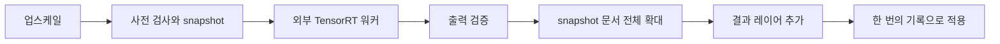

# 외부 백엔드 통합과 AI 업스케일 분석·구현 계획

최신 업데이트: [TensorRT GPU 전후처리 구현·검증](waifu2x-gpu-prepost-validation.md). 기본 추론의 전후처리는 GPU로 변경했으며 기존 CPU 결과와 동일함을 확인했다.

작성일: 2026-11-10
상태: 앱 통합 및 검증 진행 중. 공통 TensorRT 런타임에서 Janai 세 모델을 실행했고, Janai 기본 설정과 waifu2x 기본 설정을 실제 이미지로 확인했다. 문서 적용과 실행 취소의 단위 테스트도 통과했다. 앱에서의 전체 실행·시각 검증과 배포 빌드는 아직 확인하지 않았다. 아래 분석 내용 중 현재 상태를 설명하는 문장은 작성 당시의 기록이다.
분석 기준: `170ef2220`의 로컬 선택 영역 제거 구현.

## 1. 사용자 요구와 확정된 동작

- 실행 파일 옆의 백엔드 루트 이름을 `cutout-backends`에서 `external-backends`로 변경한다.
- 기존 배경 제거와 선택 영역 제거는 그대로 사용할 수 있어야 한다.
- 외부 업스케일 백엔드를 추가한다. IllustrationJaNai는 BF16 ONNX/TensorRT, waifu2x도 변환 ONNX를 TensorRT로 실행하며 ComfyUI 실행 여부와 관계없이 작동한다.
- 공통 대상은 Windows x64, NVIDIA RTX 30 시리즈 이상이다. BF16 ONNX + TensorRT 전제는 IllustrationJaNai에 적용한다. 추가 모델 `waifu2x-swin_unet_v3`는 [별도 계획](waifu2x-swin-unet-v3.md)을 따른다.
- AI 바의 맨 왼쪽 설정 톱니바퀴 바로 오른쪽에 **업스케일** 버튼을 둔다.
- **AI 모델 설정** 창에 **업스케일** 탭을 추가해 모델과 실행 매개변수를 저장한다. GPU는 자동 선택이 기본값이다. IllustrationJaNai는 타일링 ON, 타일 512px, 겹침 128px을 기본값으로 하고 OFF도 제공한다. waifu2x의 모델별 기본값은 별도 계획을 따른다.
- 결과는 **현재 문서의 크기를 키워 적용**한다. 새 문서를 만드는 방식이 아니다.
- 확대된 문서, 결과 레이어, 기존 레이어 표시 상태와 모든 좌표 변화가 **한 번의 Undo/Redo**에 포함된다.
- 특정 모델명·공급자·개인 PC 경로를 앱 Rust 코드에 고정하지 않는다.
- 전달물은 실제 파일로 구성한다. 외부 Python 설치를 참조하는 venv, 정션, 바로가기를 실행 의존성으로 사용하지 않는다.

초기 범위는 **IllustrationJaNai 네이티브 4배 모델 3종 + waifu2x-swin_unet_v3/art 네이티브 2배 모델 항목 1개**다.
배율 선택 옵션은 두지 않으며 모델에 따라 4배 또는 2배를 적용한다. waifu2x의 노이즈 설정은
해당 항목 내부의 공식 가중치 5개를 선택한다. 4배 후 축소, 다단 업스케일, 구형 waifu2x,
사진 전용 모델, TensorRT-RTX, CPU·DirectML 경로는 초기 구현에 포함하지 않는다.

이 문서의 이후 ONNX/TensorRT·4배·겹침 설명은 IllustrationJaNai 경로를 기준으로 한다.
waifu2x의 타일 보정, TTA, Auto/Disable 알파, 배치, TensorRT 혼합 정밀도 실행은
[waifu2x 추가 계획](waifu2x-swin-unet-v3.md)에 별도로 명시했다.
공통 host는 모델별 네이티브 배율·설정 capability·알파 정책을 구분해야 한다.

## 2. 확인 결과와 아직 증명되지 않은 부분

| 항목 | 확인 결과 | 증거의 범위 |
|---|---|---|
| 공식 배포물과 로컬 압축 파일 | SHA-256 일치 | 다운로드된 파일의 동일성 |
| 압축 해제된 모델 | ONNX 3개, 외부 가중치 파일 없음 | 로컬 파일·그래프 검사 |
| ONNX 구조 | 3개 모두 `onnx.checker.check_model` 통과 | ONNX 유효성; TensorRT 실행 성공을 뜻하지 않음 |
| 모델 입출력 | FP32, NCHW, RGB 3채널, 동적 공간 크기 | 로컬 ONNX 메타데이터 |
| 내부 정밀도 | BF16 가중치와 명시적 Cast 포함 | 로컬 그래프와 초기화 텐서 검사 |
| 확대 구조 | 세 모델 모두 `DepthToSpace(blocksize=2)` 두 번 | 그래프의 4배 확대 구조 |
| 관측 가능한 NVIDIA GPU | RTX 4090, CC 8.9, VRAM 24,564 MiB, 드라이버 616.56 | 현재 검증 장치의 식별; 속도·VRAM 실측 아님 |
| TensorRT 실행 환경 | 분석에 사용한 기본 Python에는 `tensorrt`가 없고 PATH에 `trtexec`도 없음 | 다른 폴더에 설치된 모든 환경을 조사한 것은 아님 |
| 세 모델의 TensorRT 파싱·엔진 생성·추론 | **미실행** | 구현 전 첫 번째 기술 검증 과제 |
| 타일 크기별 VRAM·속도·이음새 | **미측정** | 문서의 초기값은 검증할 후보이지 측정된 최적값이 아님 |

원시 메타데이터와 연산자 개수는
[모델 검사 JSON](illustrationjanai-v3-onnx-inspection.json)에 보관한다.
분석 도구의 설치 위치를 실행 패키지나 앱 코드에 연결하지 않는다.

### 공식 배포 식별

- 저장소/태그: `the-database/MangaJaNai`, `3.0.0`.
- 태그 커밋: `d2f8f92dc75303c557ca2d7a507913eff512ff32`.
- 공개일: 2025-11-26 UTC. GitHub에서는 pre-release로 표시된다.
- 파일: `IllustrationJaNai_V3_ONNX_bf16.7z`, 93,681,845 bytes.
- 공식 및 로컬 압축 파일 SHA-256:
  `48e292c3f92aa2df79f9f83c6318a6c2052c29e6ea9fe2ed23b61cc526900247`.

출처: [공식 릴리즈](https://github.com/the-database/MangaJaNai/releases/tag/3.0.0),
[릴리즈 API](https://api.github.com/repos/the-database/MangaJaNai/releases/tags/3.0.0).

## 3. 어떤 모델인가

IllustrationJaNai는 컬러 일러스트용 초해상도 모델이다. 프롬프트 기반 이미지 생성기가
아니며, CFG·샘플링 스텝·시드로 제어하는 모델이 아니다. MangaJaNai의 흑백 만화 모델들과
구분해야 한다. 생성한 미세 질감은 원본 디테일의 정확한 복원을 보증하지 않는다.

작성자는 V3detail을 질감·세부 보존 쪽으로, V3denoise를 하프톤 노이즈 제거 쪽으로
설명한다. DAT2와 HAT-L은 서로 다른 네트워크이며, HAT-L은 detail 변형만 제공된다.
릴리즈의 chaiNNer 속도 표를 이 구현의 BF16 TensorRT 성능으로 인용하면 안 된다.
[모델 소개](https://github.com/the-database/MangaJaNai),
[V3 설명](https://github.com/the-database/MangaJaNai/releases/tag/3.0.0).

### 실제 보유 파일

| 모델 파일 | 크기(bytes) | 내부 형식 | 기본 용도 제안 |
|---|---:|---|---|
| `4x_IllustrationJaNai_V3detail_DAT2_28k_bf16.onnx` | 43,629,421 | IR 12 / opset 23 | 기본 선택 후보: 일반 컬러 일러스트 |
| `4x_IllustrationJaNai_V3denoise_DAT2_27k_bf16.onnx` | 43,629,421 | IR 12 / opset 23 | 압축·인쇄 하프톤 흔적이 강한 이미지 |
| `4x_IllustrationJaNai_V3detail_HAT_L_28k_bf16.onnx` | 162,757,361 | IR 12 / opset 22 | detail 비교용 선택지; VRAM 실측 후 권장값 확정 |

세 파일의 SHA-256:

```text
detail DAT2  331b46435bb1a882ceed39b6f9a4bff2190a4eb4539993fa9b4e5ca95b221479
denoise DAT2 78c1ba6bb07fa22640641baf52a28264432a3d05fc2f1055c8d45d9cab76d7b3
detail HAT-L 77a9a3033a198123916044b9ac17a2ea641a9efb2d24583ea3907d79c703c986
```

### 입출력과 BF16의 의미

| 항목 | 로컬 파일에서 확인한 규격 |
|---|---|
| 입력 이름 | `input` |
| 입력 타입 | ONNX `FLOAT` = FP32 |
| 입력 축 | `[1, 3, H, W]` |
| 출력 이름/타입 | `output` / FP32 |
| DAT2 출력 선언 | `[unk, 3, 4*H, 4*W]`에 해당하는 기호 차원 |
| HAT-L 출력 선언 | `[Sliceoutput_dim_0, unk, height, width]`로 표기됨 |
| 내부 가중치 | DAT2: BF16 1,323개 + FP32 144개 + INT64 69개 초기화 텐서 |
| HAT-L 내부 가중치 | BF16 1,713개 + INT64 87개 초기화 텐서 |
| Cast | DAT2: BF16로 73개, FP32로 73개. HAT-L: BF16로 11개, FP32로 1개 |

HAT-L의 출력 기호 이름만 읽으면 입력과 같은 크기처럼 보일 수 있다. 이름을 크기 공식으로
취급하지 말고, TensorRT에 입력 타일 크기를 설정한 뒤 **실제 해석된 출력 크기가
`[1,3,4H,4W]`인지 검증**해야 한다. 세 그래프에는 모두 2배 PixelShuffle 구조가 두 번 있다.

모델 외부의 RGB 정규화는 `[0,1]`이다. BF16이라는 이유로 입력 버퍼를 BF16/FP16으로
전달하면 안 된다. 호스트와 워커는 FP32 I/O를 사용하고, 내부 BF16/FP32 Cast는 그대로
유지한다. 원본 모델을 일괄 `.half()`하거나 모든 연산을 BF16으로 강제하지 않는다.
[공식 export 규격](https://github.com/the-database/MangaJaNaiGUI/blob/main/tools/onnx-export/README.md),
[DAT2 export 설정](https://github.com/the-database/MangaJaNaiGUI/blob/main/tools/onnx-export/configs/4x_IllustrationJaNai_V3detail_DAT2_28k_bf16.yml),
[HAT-L export 설정](https://github.com/the-database/MangaJaNaiGUI/blob/main/tools/onnx-export/configs/4x_IllustrationJaNai_V3detail_HAT_L_28k_bf16.yml).

## 4. 실행 방식 선택: external + 직접 TensorRT API

| 방식 | 현재 요구와의 관계 | 판단 |
|---|---|---|
| 외부 프로세스에서 TensorRT 직접 실행 | BF16 ONNX를 그대로 사용하고 ComfyUI와 독립 실행 가능. 기존 외부 작업·취소 구조 활용 가능 | **권장** |
| ComfyUI 연동 | 별도의 ONNX/TensorRT 노드와 서버 모델 목록·워크플로 연동이 필요. 일반 `.pth` 업스케일 로더를 이 ONNX 파일에 바로 쓸 수 있는 것은 아님 | 현 단계 이점이 작음 |
| MangaJaNai GUI/CLI 또는 libaji 재사용 | 작성자 측 구현이 TensorRT와 타일 실행을 지원함. 다만 앱/런타임 도입 및 라이선스 검토가 추가됨 | 동작 참고 대상으로 조사; 초기 의존성으로 채택하지 않음 |

권장 외부 워커의 구성은 독립 CPython + NumPy + TensorRT Python 바인딩 + NVIDIA
CUDA Python 바인딩 및 필요한 CUDA/TensorRT DLL이다. 정확한 패키지 버전과 재배포 파일은
P0 실험 후 고정한다. ONNX Runtime TensorRT EP를 거치지 않고 직접 TensorRT를 사용해
CPU fallback과 provider 분할 실행을 피한다. PyTorch는 추론 의존성으로 추가하지 않는다.
이미지 색 관리·문서 처리는 Rust 앱이 담당한다.
ComfyUI의 기본 업스케일 로더가 PyTorch state_dict를 읽는 경로인 것도 확인했다.
[공식 로더 소스](https://github.com/Comfy-Org/ComfyUI/blob/master/comfy_extras/nodes_upscale_model.py).

TensorRT Python API에는 ONNX 파싱, 엔진 생성·저장·실행이 제공된다.
[NVIDIA Python API](https://docs.nvidia.com/deeplearning/tensorrt/latest/inference-library/python-api-docs.html).
작성자 도구의 현재 구동 경로는
[GUI](https://github.com/the-database/MangaJaNaiGUI),
[CLI](https://github.com/the-database/MangaJaNaiCLI),
[추론 엔진](https://github.com/the-database/animejanai-inference)에서 확인했다.

### TensorRT 버전과 GPU

- RTX 30 시리즈 이상 중 TensorRT가 지원하는 NVIDIA CUDA 장치를 대상으로 한다.
  초기 검사 조건은 compute capability 8.0 이상이다. AMD가 화면 출력용이어도 CUDA 장치를 별도로 찾는다.
- 초기 검증 후보는 **TensorRT 11.4.1 계열**이다. 문서상 지원과 실제 Windows 패키지
  가용성·세 모델 파싱 성공을 확인한 뒤 정확한 빌드 번호, CUDA 버전, 파일 해시를 고정한다.
- TensorRT 11은 strongly typed 네트워크를 사용한다. 타입은 ONNX 그래프가 정한다.
  옛 레시피의 `--bf16`, `--fp16`, `--best`를 그대로 붙이지 않는다.
- TensorRT 10 계열을 선택하게 된다면 해당 버전의 strongly typed 옵션과 opset 22/23
  파싱을 별도로 검증해야 한다. 버전 여러 개를 자동 재시도하는 구조는 만들지 않는다.
- CUDA 12용 pip 배포와 CUDA 13용 SDK ZIP을 혼합하지 않는다. 드라이버 최소 버전도
  선택한 CUDA 계열과 패키지에 맞춰 확인한다. `nvidia-smi`의 CUDA 표시는 Toolkit 설치 증거가 아니다.
- 초기 구현은 일반 TensorRT 하나를 사용한다. TensorRT-RTX는 별도 SDK·캐시 규격이므로 섞지 않는다.

출처:
[Precision control](https://docs.nvidia.com/deeplearning/tensorrt/latest/inference-library/precision-control.html),
[trtexec 10→11 변경](https://docs.nvidia.com/deeplearning/tensorrt/latest/api/migration/tensorrt-10x-to-11x-trtexec.html),
[ONNX opset 안내](https://docs.nvidia.com/deeplearning/tensorrt/11.4.1/reference/onnx-opset-guide.html),
[설치 전제](https://docs.nvidia.com/deeplearning/tensorrt/latest/installing-tensorrt/prerequisites.html).

## 5. 폴더 전환과 이동 가능한 배포

현재 디스크에는 이미 `external-backends`가 있고, 그 안의 기존 백엔드 폴더명도 바뀌었다.
그러나 현재 `cutout_external::discover`는 아직 실행 파일 옆의 **`cutout-backends`만** 찾는다.
따라서 디렉터리 이름을 바꾸는 것과 앱의 탐색 경로 변경을 구분해야 한다.

최종 실행·배포 구조는 업스케일 한 폴더로 통합한다. 현재 실험 폴더의 위치와 구분한다.

```text
PhotoCraft/
  photocraft.exe
  external-backends/
    photoshop-cutout/
      backend.json
      ...existing files...
    windows-ai-remover/
      backend.json
      ...existing files...
    upscale/
      backend.json
      python/                          # TensorRT/CUDA/NumPy를 포함한 단일 독립 런타임
      runtime/                         # 실행 코드·GPU 전후처리 커널
      models/
        janai/                         # BF16 ONNX 3개
        waifu2x/                       # 변환 ONNX 5개, UI에서는 모델 항목 하나
      cache/
        tensorrt/                      # 모델·GPU·타일·배치별 엔진
        cuda/                          # 전후처리 커널 캐시
      licenses/
```

원본 ZIP/7z, 공식 소스, PyTorch 변환·기준 비교 환경, 실험 결과 이미지는 실행용 폴더에
포함하지 않는다. 개발 자료로 따로 보관하며 사용자 원본을 임의 삭제하지 않는다.
`upscale`의 이름을 바꿔도 manifest와 내부 상대 경로로 동작해야 한다.

1. 앱의 정식 루트를 `external-backends`로 변경한다. 상위 경로는 항상 실행 파일에서 계산한다.
2. 개별 폴더명 대신 manifest의 안정적인 `id`와 `operation`으로 구분한다.
   기존 `id: local-device`, `id: local-window-model`을 폴더명에 맞춰 억지로 바꾸지 않는다.
3. 기존 PS/W 워커가 쓰는 `PHOTOCRAFT_CUTOUT_*` 변수는 당장 유지한다. 루트 이름 변경을
   이유로 정상인 기존 워커 프로토콜까지 동시에 깨뜨리지 않는다.
4. 압축 파일이나 `backend.json`이 없는 모델 폴더는 실행 가능한 백엔드로 간주하지 않는다.
5. 기존 `cutout-backends` 자동 검색, 개인 PC의 원래 폴더를 가리키는 정션 등은 추가하지 않는다.
6. 앱과 backend가 함께 있는 폴더를 다른 경로로 옮겨 실제 실행해야 배포 검증을 통과한다.

### 단일 업스케일 백엔드에서 런타임 공유

Janai와 waifu2x를 하나의 `operation: upscale` 백엔드와 모델 catalog로 묶는다.
`upscale/python`을 한 번만 포함하고 manifest의 `executable`은 `python/python.exe`로 둔다.
모델별 entrypoint·절대경로나 별도 `_runtimes` 참조 기능을 만들지 않는다.
기존 `local_file`의 백엔드 루트 포함 검사를 그대로 재사용할 수 있다.
모델별 네이티브 배율·지원 설정·정밀도·알파 정책은 catalog에서 구분한다.

현재 `_runtimes/tensorrt-python312`는 검증용으로 준비한 실제 런타임 위치다.
배포 구조를 만들 때 실제 파일을 `upscale/python`에 포함한다. 기존 폴더에 대한 정션을
두거나 `executable: "../..."`로 경로 검사를 우회하지 않는다. 각 모델 가중치와 엔진은 별개다.

### 패키지의 필수 조건

- Python 실행 파일·표준 라이브러리·확장 모듈·NumPy·TensorRT 바인딩·필요 GPU DLL이
  패키지 안에서 해결된다. 일반 venv의 외부 `home` 경로에 의존하지 않는다.
- `_pth`, manifest, 모델 목록, DLL 탐색 위치는 패키지 상대 경로로 작성한다.
- 외부 `PATH`, `PYTHONHOME`, `PYTHONPATH`, 시스템 Python, 기존 ComfyUI 설치를 실행 조건으로 삼지 않는다.
- TensorRT의 parser·builder resource·실행 DLL, Python 확장 모듈, CUDA 런타임, 필요한 VC 런타임을 실제 dependency 목록으로 고정하고 누락을 검사한다.
- NVIDIA 드라이버는 시스템 전제다. CUDA Toolkit 전체나 Visual Studio가 사용자 PC에
  설치되어 있어야 한다고 암묵적으로 가정하지 않는다. 필요한 재배포 런타임은 검증·동봉한다.
- ZIP은 실제 파일을 담고 정션·symlink·`.lnk` 연결물을 실행 의존성으로 포함하지 않는다.
- TensorRT 엔진은 폴더 이동성과 별개다. GPU·런타임이 다르면 그 환경에서 새로 빌드한다.

## 6. 백엔드 프로토콜 확장

기존 manifest의 `operation`에 `upscale`을 추가한다. `cutout`, `erase`의 기존 의미와
폴더명 독립 동작을 유지한다. 공통 프로세스 실행·파일 검증·취소 코드는 기존 호스트에서 공유한다.
단, **동일 크기 출력 검사와 고정 10분 제한을 업스케일에 그대로 적용하지 않는다.**

예시이며 아직 구현된 manifest가 아니다:

```json
{
  "version": 1,
  "id": "upscale",
  "operation": "upscale",
  "label": "SR",
  "executable": "python/python.exe",
  "args": ["runtime/addon.py"],
  "required": ["runtime/addon.py", "python/python.exe"],
  "models": [
    {
      "id": "detail-dat2",
      "label": "IllustrationJaNai V3 detail DAT2",
      "file": "models/janai/4x_IllustrationJaNai_V3detail_DAT2_28k_bf16.onnx",
      "scale": 4,
      "precision": "bf16"
    }
  ]
}
```

실제 `required`에는 독립 런타임에 필요한 파일 목록을 추가한다. 모델별 준비 상태는
개별 검사해, 모델 하나를 빼더라도 나머지 모델까지 무효화되지 않게 한다.

### 앱과 워커의 데이터 계약

다음은 구현할 계약안이다. PS/W의 기존 프로토콜은 유지한다.

| 항목 | 제안 |
|---|---|
| `PHOTOCRAFT_BACKEND_ROOT` | manifest 검증을 통과한 백엔드 루트 |
| `PHOTOCRAFT_BACKEND_REQUEST` | 버전이 포함된 JSON 요청 파일 |
| `PHOTOCRAFT_BACKEND_RESULT` | 결과 JSON 저장 위치 |
| `PHOTOCRAFT_BACKEND_CANCEL` | 취소 알림 파일 |
| 요청 | 모델/백엔드 ID, GPU ID, 모델 고유 배율, 입력/출력 크기, 모델별 옵션과 데이터 파일 위치 |
| 픽셀 | little-endian 행 우선 RGB FP32와 선택적 alpha FP32. 워커가 모델용 NCHW로 변환 |
| 결과 | 성공 여부, 실제 출력 크기·타입·길이, 선택적 alpha 및 알파 정책, GPU, 실행 런타임 버전, 모델 hash, 캐시 사용 여부, 소요 시간 |
| 진행 상태 | 엔진 생성과 이미지 타일 처리를 구분해 기존 JobCtx에 전달 |

작업할 때 계산한 임시 파일 위치를 절대경로로 전달하는 것은 정상이다.
**개발 PC의 고정 절대경로를 코드나 설정에 저장하는 것과 구분한다.**
요청·결과 JSON 크기 제한, 모델 경로의 루트 포함 여부, 출력 크기의 checked 연산,
파일 길이와 실제 픽셀 형식을 검증한다. 프로세스의 성공 종료만으로 결과를 신뢰하지 않는다.

기존 8-bit PNG 경로를 그대로 재사용하면 16/32-bit 문서가 입력 전부터 8-bit로 양자화된다.
업스케일의 외부 계약은 FP32 픽셀을 유지한다. 전체 출력을 여러 벌 RAM에 올리지 않도록
파일/메모리 매핑과 행 밴드 읽기·쓰기를 사용한다. 호스트가 관리하는 일시 출력 영역에서만 결과를 읽는다.

## 7. TensorRT 실행과 캐시

### 첫 번째 기술 검증

1. 세 모델을 원본 그대로 ONNX parser에 전달하고 오류를 모두 기록한다.
2. 256/512/1024 타일과 여러 겹침 폭을 시험한다. 기본 실행은 batch 1 고정 타일을 사용하고, 타일링 OFF의 전체 이미지 추론도 별도로 검증한다.
3. 입력/출력 이름·타입·크기를 실제 engine/context에서 확인한다.
4. 단색·그라데이션·선화를 이용해 4배 치수, 유한값, 검정 출력·큰 색 왜곡 여부를 확인한다.
5. 내부 BF16/FP32 혼합을 유지한다. 실패했다고 FP16 모델이나 CPU로 조용히 바꾸지 않는다.
6. 이 단계를 통과하기 전에 UI만 완성해 지원이 끝났다고 표시하지 않는다.

ONNX checker 성공과 opset 범위 일치가 모든 연산·동적 shape의 TensorRT 실행을 증명하지는
않는다. 그래프 수정이 필요하면 원본을 덮어쓰지 않는다. 오류 원인과 수치 비교를 확인한 뒤
별도 파생 파일로 만들고 출처·변환·hash를 기록한다.

### 타일 처리

- 타일링 기본값은 ON, 타일 크기 기본값은 입력 512px, 인접 타일 사이의 전체 겹침 기본값은 128px이다. 이는 공식 엔진의 설정을 기준으로 한 사용자 결정이며, 이 구현과 모델에서 최적이라는 성능 검증 결과는 아니다. 256/512/1024와 여러 겹침 폭을 실측하고, 128은 메모리 부족 시 추가 후보로 검토한다. 타일은 필요한 배수로 맞추고 끝 부분은 padding한다.
- 타일링 OFF는 입력 전체를 한 번에 추론한다. 모델이 요구하는 경계 padding은 허용하되 여러 타일로 분할하지 않고, padding을 제거해 정확한 4배 결과를 돌려준다. 이미지 크기별 TensorRT 입력 shape/profile과 캐시를 분리한다.
- OFF에서는 타일 크기·겹침 입력을 비활성화하되 저장값은 유지한다. 메모리가 모자라면 원본을 보존하고 오류를 알린다. 설정을 바꾸거나 타일링으로 몰래 전환하지 않는다.
- 원본이 타일보다 작거나 가로·세로가 홀수인 경우를 처리한다. 한 변이 1인 이미지에서 잘못된 reflect padding을 호출하지 않는다.
- 인접 타일을 겹쳐 합성한다. 출력의 겹침 폭은 입력 기준 폭의 4배다.
- 공식 CLI의 참고 설정은 입력 타일 512px, 인접 타일의 총 겹침 128px이다. 256/128 조합을 공식 권장값이라고 볼 근거는 없다. 겹침은 `0 < overlap < tile`을 만족해야 하며, 512/128 외에 256/32·256/64·512/32·512/64·1024/64·1024/128 등을 모델별로 비교한다.
- 공식 구현은 겹침 중앙의 좁은 영역을 합성한다. 별도 구현에서 겹침 영역 전체에 가중치를 주는 방식은 같은 결과가 아니므로 독립적으로 품질을 검증한다. 사용자가 정한 기본값 512/128을 기준으로 동일 이미지의 추론 시간·peak VRAM·경계 품질을 측정한다. 실측만으로 기본값을 임의 변경하지 않는다.
- 가장자리·모서리·내부의 가중치를 정규화해 빈 구멍, 이중 합산, 경계 암화를 막는다.
- full-frame과 tiled 결과를 비교한다. 빠르게 실행된다는 사실만으로 이음새가 없다고 판단하지 않는다.
- OOM에서 모델·정밀도·GPU를 자동으로 바꾸지 않는다. 더 작은 타일을 선택할 수 있는 오류를 반환한다.

작성자의 공개 이미지 API는 기본 타일 512px, 인접 타일 간 최소 겹침 128px을 사용한다. 이는 만화 스크린톤 등 질감의 이음새를 고려한 작성자의 선택이며, 이 프로젝트의 일러스트 모델과 독립 구현에 그대로 최적이라고 검증된 값은 아니다. [공식 CLI 설명](https://github.com/the-database/MangaJaNaiCLI).

공개 이미지 API는 고정 타일·겹침·끝부분 padding을 다룬다. 해당 구현 코드를
복사하지 않고 동작을 참고한다.
[aji_image.h](https://github.com/the-database/animejanai-inference/blob/main/include/aji_image.h).

### 엔진 저장

캐시 키는 모델 SHA-256, TensorRT/CUDA 버전, GPU 식별·compute capability, 관련 드라이버
정보, 타일링 ON/OFF, 실제 I/O shape, 타일 크기, builder 설정, 워커 구현 버전을 반영한다. 모델의 절대경로를
키로 삼지 않는다. 겹침 폭은 통상 engine shape를 바꾸지 않으므로 불필요한 재빌드 조건으로 넣지 않는다.

- 최초 실행은 엔진을 만들고, 이후 같은 조건에서는 재사용한다.
- 일시 파일에 기록한 뒤 성공했을 때만 정식 캐시 이름으로 바꾼다.
- 불일치·손상·다른 GPU의 엔진은 사용하지 않고 현재 조건으로 다시 만든다.
- `cache/`는 백엔드 아래 쓰기 가능한 위치에 둔다. 개발 PC의 원래 폴더로 연결하지 않는다.
- 엔진 생성 중 취소하거나 실패하면 미완성 파일을 정상 캐시로 남기지 않는다.
- 최초 엔진 빌드와 이미지 추론의 시간 제한은 나누어 실측 후 정한다. 기존 600초를 무조건 재사용하지 않는다.
- 작업별 자식 프로세스 종료로 취소할 수 있어야 하며, 문서를 적용하지 않고 GPU 메모리도 해제한다.

GPU나 TensorRT 버전이 다른 PC로 engine을 옮기는 데에는 호환성 조건이 있다.
이동 가능한 ONNX·런타임·설정과, GPU별로 생성한 engine의 무조건 재사용을 혼동하지 않는다.
[NVIDIA Engine Compatibility](https://docs.nvidia.com/deeplearning/tensorrt/latest/inference-library/engine-compatibility.html).

## 8. 색·알파·문서 적용

### 모델 입력

- 대상은 현재 보이는 **전체 문서 합성 이미지**다. 활성 레이어만 또는 선택 영역만 처리하지 않는다.
- 네이티브 해상도에서 타일화한다. Qwen용 축소·패딩 입력을 재사용하지 않는다.
- ICC 변환으로 모델용 sRGB 인코딩 RGB를 만들고, NCHW RGB 순서의 0..1 값을 전달한다. BGR/-1..1을 사용하지 않는다.
- Gray는 RGB로 펼친 뒤 결과를 문서 색 모드로 돌린다. CMYK/Lab도 기존 CMS로 왕복한다.
- 초기 대상은 SDR 8/16/32-bit 문서다. HDR이나 범위 밖 값을 조용히 잘라내지 않는다.
  별도 HDR 처리가 없는 단계에서는 해당 입력을 이유와 함께 거절한다.

### 알파

모델은 3채널 RGB용이므로 알파를 생성시키지 않는다. 원래 알파를 적절한 기존 보간법으로
4배 확대한다. RGB는 투명 경계의 색을 적절히 연장해 검은 투명 픽셀이 경계에 섞이지 않게
입력을 준비한다. 검정/흰 배경으로 두 번 추론해 알파를 새로 추정하는 방식은 초기안에
포함하지 않는다. 완전 투명·반투명·가느다란 윤곽선 테스트를 필수로 둔다.

### 한 번의 편집으로 적용



1. `jobs::run`에 해당하는 경로에서 문서 snapshot과 설정을 고정한다. 추론 전에 문서를 먼저 확대하지 않는다.
2. 외부 결과를 검증한 뒤 성공한 snapshot에 `image_cmds::resample_doc`으로 전체 문서를 확대한다.
3. 레이어·마스크·선택·채널·텍스트/벡터·가이드·효과·포함된 콘텐츠의 기하 처리는 기존 Image Size 경로를 이용하고 대응 범위를 테스트한다.
4. 확대된 기존 레이어 구조는 유지하고 맨 위에 AI 결과 래스터 레이어를 둔다.
   이중 합성을 막기 위해 기존 레이어를 숨긴다. 완전한 원래 크기·픽셀로 돌아가는 동작은 Undo다.
5. Color Sampler 등 Session 쪽 좌표도 같은 배율로 한 번만 갱신한다.
6. 결과 전체를 한 번의 `Session::edit`로 적용한다. `image.imageSize`를 먼저 execute하고 별도 기록으로 AI 레이어를 추가하지 않는다.
7. 취소·GPU 오류·잘못된 출력·적용 실패에서 문서 크기, 레이어, 히스토리와 Redo를 바꾸지 않는다.
8. 문서 ID와 상태를 검증해 다른 탭에 잘못 적용하지 않는다.

### 메모리 예산

4배는 가로·세로 각각 4배, 픽셀 수는 **16배**다. 타일화는 GPU 임시 메모리를 줄이지만,
확대된 문서와 Undo가 차지하는 RAM을 없애지 않는다.

| 입력 | 출력 | 출력 픽셀 수 | RGBA32F 한 장만의 개략 용량 |
|---|---|---:|---:|
| 1920×1080 | 7680×4320 | 33,177,600 | 약 506 MiB |
| 3840×2160 | 15360×8640 | 132,710,400 | 약 1.98 GiB |
| 6000×4000 | 24000×16000 | 384,000,000 | 약 5.72 GiB |

사전 검사에는 `check_resample_budget`, `check_working_budget`, `memory_gate::image_size_need`의
기존 방식을 이용하고 AI 출력 레이어·합성·알파용 추가 메모리도 포함한다. 현재 64-bit 버전의
단일 resample 예산은 8 GiB지만, 이것만으로 여러 레이어 전체가 들어간다고 판단하지 않는다.
캔버스 밖의 숨은 픽셀, 스마트 오브젝트, 표시용 텍스처 치수도 확인한다. Qwen용 36MP 제한을
새 출력에 그대로 재사용하지 않고, 출력 전용 예산으로 시작 전에 결정한다.

## 9. UI와 설정

### AI 바

배치 예시:

```text
ComfyUI 있음:                  [⚙] [업스케일] [기존 모델/생성 컨트롤 ...]
ComfyUI 없음·부분 선택 없음:   [⚙] [업스케일] [배경 제거] [PS]
ComfyUI 없음·부분 선택 있음:   [⚙] [업스케일] [제거] [W]
업스케일 백엔드만 준비됨:      [⚙] [업스케일]
```

- 업스케일은 선택이 있어도 문서 전체에 적용한다. 툴팁으로 이 차이를 전달한다.
- 백엔드·GPU·모델이 준비되면 ComfyUI 없이 사용할 수 있다.
- 부분 선택/흰색/투명 캔버스라는 생성 모드 분류 때문에 버튼을 숨기지 않는다.
- 작업 중 같은 문서를 바꾸는 동작은 기존 job 방식으로 제한하고 진행·취소를 제공한다.
- GPU 미지원, 모델·런타임 누락은 설정 화면에서 이유를 표시한다.
- 영어·한국어, 좁은 창, 프롬프트 편집을 연 상태에서도 배치를 확인한다.

### 업스케일 탭

아래 표는 IllustrationJaNai 선택 시의 설정이다. waifu2x는 별도 계획의 노이즈·타일·알파·TTA·배치 설정을 보여 준다. 모델을 전환해도 각 설정을 별도로 기억한다.

| 설정 | 초기안 | 의미 |
|---|---|---|
| 모델 | catalog의 IllustrationJaNai 3종과 waifu2x-swin_unet_v3 항목 | Rust에 모델 파일명을 넣지 않음 |
| 배율 | 초기에는 네이티브 4x | 실행 전 변경 후 치수도 표시 |
| GPU | 자동 선택(기본값) / 검출된 지원 NVIDIA GPU | 모니터 연결이 아닌 CUDA 장치로 선택 |
| 타일링 | ON(기본값) / OFF | OFF는 전체 이미지를 나누지 않고 추론 |
| 타일 크기 | 512px(기본값), 다른 크기 선택 가능 | 입력 기준 엔진 타일 크기 |
| 겹침 크기 | 128px(기본값), 다른 크기 선택 가능 | 입력 기준 인접 타일의 전체 겹침 폭. 타일보다 작아야 함 |
| 고급: workspace | P0에서 정한 상한 | 전체 VRAM 제한이 아닌 builder용 workspace |
| 캐시 | 상태 표시와 명시적인 재생성 | 비호환 엔진을 억지로 읽지 않음 |

CFG, steps, negative prompt, seed, text encoder는 이 탭에 추가하지 않는다.
모델에 없는 denoise 강도나 샤프니스도 만들지 않는다.

현재 탭 상태 `model_settings_te_tab: bool`을 Models/Encoders/Upscale enum으로 변경한다.
control API는 기존 `models`/`encoders`를 유지하면서 `upscale`을 추가한다.
`ComfyUI port`는 업스케일 설정과 분리한다. 로컬 설정 저장을 ComfyUI 연결이나 다른 탭의
미저장 문자열에 의존시키지 않는다. 전용 타입의 preferences로 저장·검증한다.
저장한 모델/GPU ID가 사라졌다면 다른 모델이나 CPU를 몰래 쓰지 않고 다시 선택하도록 안내한다.

## 10. 구현 위치 대응표

| 대상 | 현재 진입점 | 계획 |
|---|---|---|
| 공통 외부 호스트 | `crates/engine/src/ai_cmds/cutout_external.rs` | 새 루트, upscale 종류, manifest/catalog, 실행·검증 공유. 역할에 맞는 이름으로 정리 |
| 업스케일 처리 | 새로운 engine module | `image.aiUpscale` 등의 전용 명령, preflight, snapshot, 외부 처리, 단일 Undo |
| 명령 등록 | `ai_cmds::specs` / `commands.rs`의 기존 확장점 | 적절한 한 곳에서 등록해 CLI/control/MCP도 같은 명령을 사용 |
| 크기/좌표 | `cmd/image_cmds.rs`, `canvas_geom.rs`, `memory_gate.rs` | 기존 resize와 예산 계산 재사용. Session 좌표는 적용할 때 한 번만 갱신 |
| AI 바/설정 | `crates/ui-egui/src/ai_bar.rs` | 기어 오른쪽 버튼, 오프라인 표시, 설정 탭. 필요한 부분만 분리 |
| 저장 | `crates/engine/src/prefs.rs` | 업스케일 설정·검증, 이전 prefs용 default |
| 자동 조작 | `crates/ui-egui/src/control/ai.rs` 등 | 새 탭 선택, 준비 상태/설정 inspect, 기존 탭 문자열 유지 |
| 문서 | `docs/external-cutout-backends.md` | 일반화된 이름으로 옮기고 새 루트·upscale 계약 및 참조 링크 갱신 |
| 외부 모델 폴더 | `external-backends/IllustrationJaNai_V3_ONNX_bf16` | manifest, 독립 런타임, 워커, 로컬 cache 추가 |
| 배포 검증 | 필요한 기존 package/verification scripts | 앱과 별도 모델 배포 구분. 실제 완전 패키지는 이동 실행으로 검증 |

모델·개인 설정·생성 엔진을 Git에 추가하지 않는다. 기능 PR에 CI 워크플로 변경을 섞지 않는다.
공개 배포를 시작하는 것은 이번 분석·구현 허가와 구분한다.

## 11. 구현 순서와 완료 기준

### P0: GPU 실행의 최소 실증

세 ONNX를 parser/build/작은 이미지 추론으로 검사해 TensorRT/CUDA/드라이버 조합을 고정한다.
128/256/512/1024 타일별 가능 여부, 출력 shape, FP32 I/O, BF16 경로, 최초 생성 시간,
warm 추론 시간과 peak VRAM을 기록한다. HAT-L의 출력 메타데이터를 신뢰하지 말고 실측한다.
미지원 연산자가 있으면 먼저 원인을 해결한다.

### P1: external-backends 루트 전환

새 루트와 기존 두 종류의 검출을 테스트한다. 폴더명과 manifest ID의 차이를 유지한다.
PS/W가 새 루트에서 실제로 기동하는지 확인한다. 누락·잘못된 manifest는 표시하지 않는다.

### P2: 명령과 단일 Undo

fake backend로 치수·색·알파·기하·오류·취소 테스트를 먼저 만든다. 현재 문서를 선택한 모델의 네이티브 배율(2배/4배)로 확대해
적용하고 Undo 한 번으로 원래 문서, Redo 한 번으로 결과로 돌아가야 한다. 출력 검증 전에
canvas와 sampler를 바꾸지 않는다.

### P3: UI와 저장

기어 오른쪽 버튼, 세 번째 설정 탭, 오프라인 검출, 저장/복원, control API를 구현한다.
ComfyUI를 실제로 끈 상태에서도 표시·실행되는지 확인하고 화면 이미지를 검토한다.

### P4: 패키지와 실기 확인

폴더 이동만으로 실행되는 실제 파일 구성을 만든다. 다른 경로로 펼친 뒤 원래 Python과
ComfyUI를 PATH에서 제외하고 엔진 재생성·실추론한다. 다른 GPU에서는 엔진을 다시 만드는지
확인한다. 다음 조건도 함께 검사한다.

- 원래 개발 폴더를 참조할 수 없는 별도 PC/VM 또는 통제된 환경에서 검증한다.
- `sys.prefix`, `sys.base_prefix`, `sys.path`, 패키지 위치와 실제 로드된 DLL 위치를 확인한다.
- OS/그래픽 드라이버를 제외한 런타임이 복사한 패키지 안에서 해결되는지 확인한다.
- venv `home`, 정션, `.lnk`, 환경변수, 원래 ComfyUI의 CUDA DLL에 기대지 않는다.

import 성공, PATH에서 Python만 제거한 검사, 복사 원본에 연결된 실행,
정적인 manifest 검사만으로 이동 가능하다고 결론 내리지 않는다.

### 필수 확인 항목

- IllustrationJaNai 3모델의 4배 및 waifu2x V3 노이즈 5단계의 2배 실제 추론, dtype/byte 길이/NaN·Inf 검사.
- 투명·반투명, RGB/Gray/CMYK/Lab, 8/16/32-bit SDR, ICC 왕복.
- 홀수 크기, 타일 경계, 끝·모서리, 작은 이미지, 캔버스 밖의 숨겨진 픽셀.
- 레이어·선택·가이드·마스크·텍스트 등 확대와 단일 Undo/Redo.
- 출력 과대, RAM/VRAM 부족, 잘못된 결과, GPU/모델 소실, 취소 시 원본 불변.
- 타일링 ON/OFF 실제 실행, OFF에서 강제 분할이 없는지, 전체 이미지 OOM 시 원본 불변과 오류 표시.
- cache cold/warm, 모델 교체, 타일·타일링 모드·전체 이미지 shape 변경, 런타임 업데이트, 다른 GPU에서의 무효화.
- ComfyUI 없음, PS만 있음, W만 있음, upscale만 있음, 여러 종류 동시 검출.
- 좁은 창과 한국어/영어 UI. 기어 바로 다음에 업스케일이 있어야 함.
- 해당 crate 테스트, Clippy, layers, wasm, 명령 panic_hunt, parity/scorecard 재생성.
- 24~36MP 입력도 확대 후 예산을 먼저 평가한다. 실행 가능한 크기로 시간·VRAM·RAM을
  측정하고 예산 밖은 시작 전에 거절한다. 작성자의 다른 환경 수치를 실측값처럼 쓰지 않는다.
- PhotoCraft 빌드 전후 당일 날짜 prefix와 정확한 상위 semantic version을 확인한다.

## 12. 라이선스와 남은 검증

공식 모델 저장소는 **CC-BY-NC-4.0**이며, 현재 저장소의 라이선스 허용 목록에 포함되지 않는다.
GUI/CLI는 GPL-3.0이다. 사용자가 둔 모델을 로컬 외부 백엔드로 쓰는 것과 PhotoCraft 소스나
공개 ZIP에 모델·다른 프로젝트 코드를 포함하는 행위는 구분한다. 후자를 이번 계획으로
자동 승인된 것으로 취급하지 않는다. TensorRT/CUDA 재배포 조건도 실제 동봉 파일별로 확인한다.
IllustrationJaNai용 TensorRT 설치·엔진 생성은 아직 하지 않았다. waifu2x는 별도 문서에 기록한 공통 TensorRT 환경과 대표 비교를 준비·실행했으며, 모델이나 런타임의 공개 배포는 추가하지 않았다.
[모델 라이선스](https://github.com/the-database/MangaJaNai/blob/main/LICENSE),
[CLI 라이선스](https://github.com/the-database/MangaJaNaiCLI/blob/main/LICENSE),
[TensorRT 라이선스](https://docs.nvidia.com/deeplearning/tensorrt/latest/reference/sla.html).

남은 핵심은 실제 TensorRT 엔진 생성, 모델별 타일/VRAM, 화질·이음새, 배포 런타임 구성,
RTX 30 시리즈 최소 구성에서의 실기 검증이다. RTX 4090의 존재와 ONNX checker 성공만으로
이 항목들을 달성했다고 판단하지 않는다.

## 13. 참고 소스 고정 정보

변할 수 있는 main 문서는 분석할 때의 커밋도 남긴다.

- MangaJaNai 모델 tag `3.0.0`: `d2f8f92dc75303c557ca2d7a507913eff512ff32`.
- MangaJaNaiGUI: `93e1b1eb92ea3dc4f692c685626da485979a0717`.
- animejanai-inference: `458c2f08a2f4dd5fa863adac38b957ee503ce9c4`.
- MangaJaNaiCLI: `0d9d3d07100527a54b761d775d8b029465a7d474`.
- TensorRT는 작성 당시 공식 11.4.1 문서를 참고했다. 구현 시 실제 고정 배포판과 대조한다.

로컬 파일 측정·코드 확인, 공식 자료 설명, 아직 구현하지 않은 설계안을 혼동하지 않는다.
